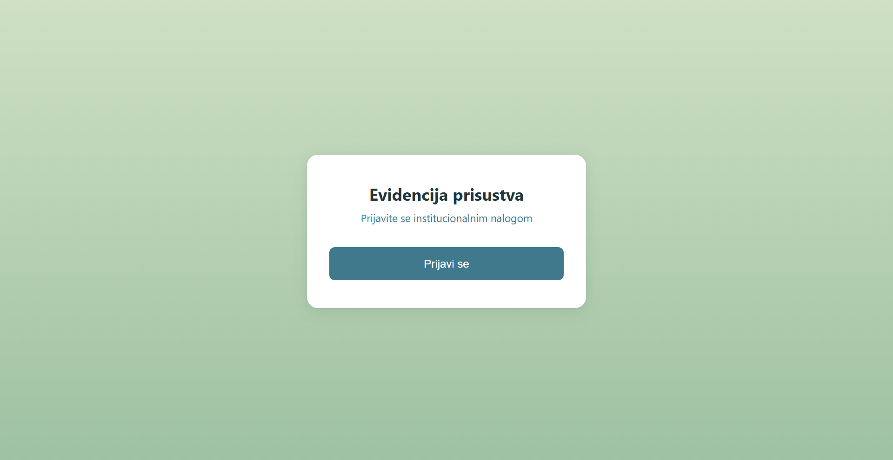
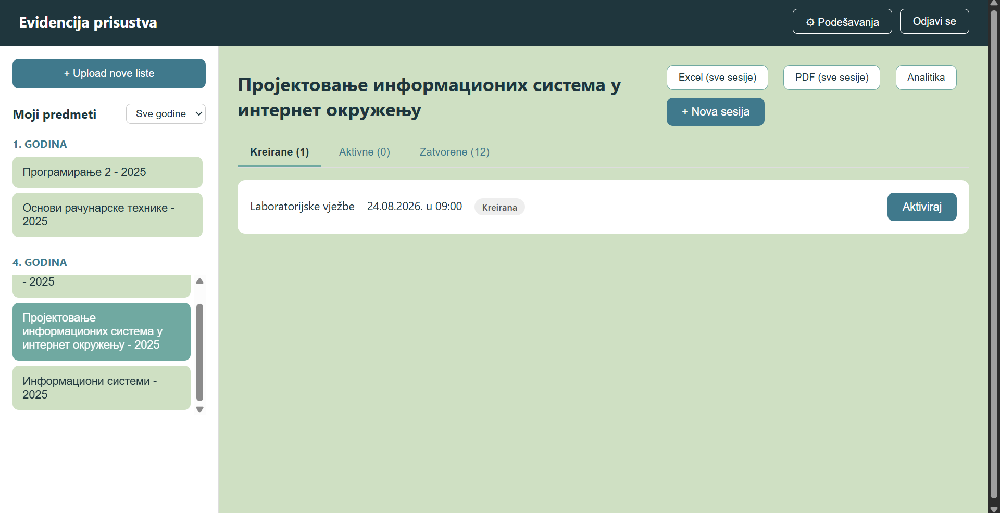
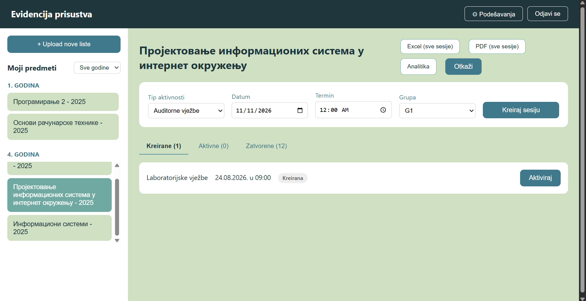
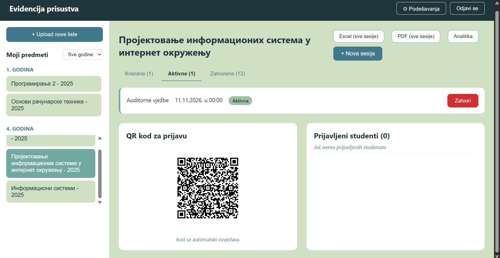
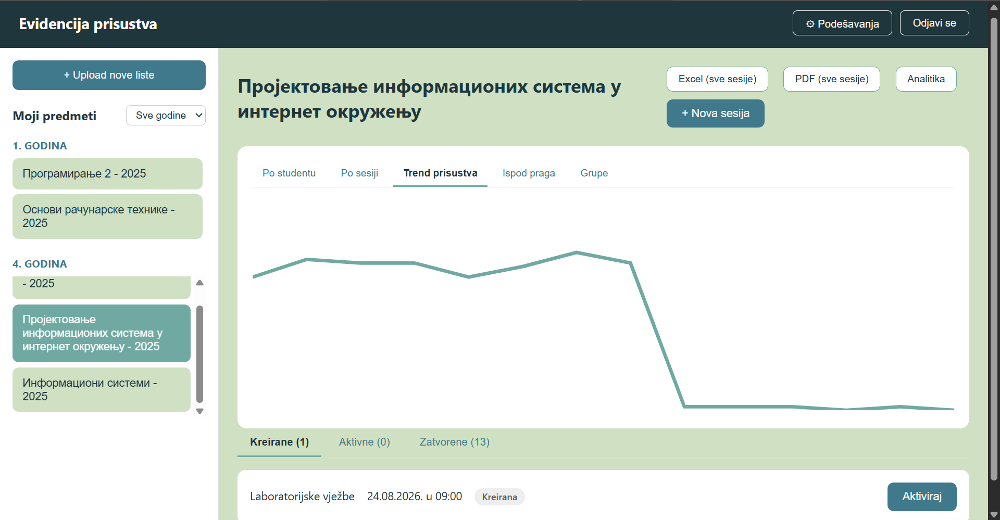

# Sistem za evidenciju prisustva putem QR koda

Web-bazirani i kontejnerizovani sistem za digitalnu evidenciju prisustva na predavanjima, auditorijskim i laboratorijskim vježbama. Sistem je zasnovan na dinamičkim QR kodovima, OAuth2/OIDC autentifikaciji i mikroservisnoj arhitekturi.

## Sadržaj

- [Pregled arhitekture](#pregled-arhitekture)
- [Tehnologije](#tehnologije)
- [Uputstvo za pokretanje](#uputstvo-za-pokretanje)
- [Podešavanje za mobilni pristup (HTTPS)](#podešavanje-za-mobilni-pristup-https)
- [Sigurnosni mehanizmi](#sigurnosni-mehanizmi)
- [Privatnost podataka](#privatnost-podataka)
- [Poznata ograničenja](#poznata-ograničenja)
- [Prikaz korisničkog interfejsa](#prikaz-korisničkog-interfejsa)
---

## Pregled arhitekture

Sistem se sastoji od šest kontejnerizovanih komponenti:

| Komponenta | Uloga | Port |
|---|---|---|
| `evidencija-backend` | Glavni Spring Boot servis – autentifikacija, predmeti, sesije, QR kodovi i izvoz podataka | 8081 |
| `analytics-service` | Odvojen Spring Boot servis – analitički pregled prisustva | 8082 |
| `eureka-server` | Service discovery registar za backend komponente | 8761 |
| `keycloak` | OIDC identity provider | 8080 |
| `mysql` | Relaciona baza podataka | 3307 (host) |
| `frontend` | Angular aplikacija, servirana preko Nginx-a sa HTTPS terminacijom | 443 |

`analytics-service` ne pristupa direktno bazi podataka za sve potrebne podatke, već odgovarajuće zahtjeve upućuje prema `evidencija-backend` servisu putem REST interfejsa. Glavni backend servis pronalazi se dinamički preko Eureka registra, bez korištenja hardkodovane adrese.

Na ovaj način ostvarena je komunikacija između dvije logički odvojene backend komponente putem REST interfejsa, uz korištenje mehanizma za dinamičko otkrivanje servisa.

## Tehnologije

- **Backend:** Spring Boot 4, Spring Security (OAuth2 Resource Server), Spring Data JPA, Spring Cloud Netflix Eureka
- **Frontend:** Angular 21 (standalone komponente), keycloak-angular, PWA podrška
- **Baza podataka:** MySQL 8
- **Autentifikacija:** Keycloak 25 (OIDC, Authorization Code Flow)
- **Izvoz podataka:** Apache POI (Excel), OpenPDF (PDF, sa ugrađenim Noto Sans fontom radi ispravnog prikaza ćirilice)
- **Kontejnerizacija:** Docker Compose

## Uputstvo za pokretanje

### Preduslovi

- Docker Desktop (sa uključenim WSL2 backend-om na Windows-u)
- Slobodni portovi: 3307, 443, 8080, 8081, 8082, 8761

### Pokretanje

Iz korijenskog foldera projekta pokrenuti komandu:

```bash
docker compose up -d --build
```

Prvo pokretanje traje nekoliko minuta jer Maven i npm preuzimaju potrebne zavisnosti unutar kontejnera.

Naredna pokretanja, bez izmjena koda, mogu se izvršiti bez `--build` opcije, što je znatno brže:

```bash
docker compose up -d
```

Provjera statusa kontejnera:

```bash
docker compose ps
```

Svih šest kontejnera treba da bude u statusu `Up`.

### Pristup sistemu

Aplikacija je dostupna na dva načina, zavisno od uređaja sa kojeg se pristupa.

**Sa istog računara na kojem su kontejneri pokrenuti:**

- Frontend: `https://localhost`
- Keycloak administratorska konzola: `http://localhost:8080`
- Eureka registar servisa: `http://localhost:8761`

**Sa mobilnog uređaja ili drugog računara u istoj lokalnoj mreži:**

- Frontend: `https://<IP_adresa_racunara>` (npr. `https://172.20.10.2`), uz prethodno podešen razvojni SSL sertifikat.
- Keycloak mora biti dostupan preko HTTPS adrese koju koristi frontend. Za pristup sa mobilnog uređaja potrebno je odgovarajuće HTTPS proksiranje Keycloak servisa kroz Nginx, u skladu sa konfiguracijom sistema.

IP adresa računara zavisi od trenutno korištene mreže i može se promijeniti prilikom povezivanja na drugu mrežu. Trenutnu adresu moguće je provjeriti komandom `ipconfig` na Windows-u, odnosno `ifconfig` ili `ip addr` na Linux/macOS sistemima.

### Početno podešavanje Keycloak-a

Realm, klijent i testni korisnici ne kreiraju se automatski, već ih je potrebno podesiti prilikom prvog pokretanja sistema:

1. Kreirati realm `evidencija`.
2. Kreirati klijent `evidencija-frontend` sa tipom pristupa `public` i odgovarajućim podešavanjima za OAuth2/OIDC Authorization Code Flow.
3. Podesiti Valid Redirect URIs prema adresi frontend aplikacije.
4. Kreirati realm role `employee` i `student`.
5. Kreirati najmanje jednog testnog korisnika za svaku ulogu, sa email adresom u formatu `ime.prezime@<konfigurisani_domen>`.

Administratorski i korisnički pristupni podaci definišu se prilikom inicijalne konfiguracije i nisu dio javne dokumentacije.

### Konfiguracija domena i ostalih podešavanja

Institucionalni domen koji se koristi u email adresama korisnika, kao i interval osvježavanja QR koda aktivne sesije, podešavaju se kroz aplikaciju, u sekciji **Podešavanja**, dostupnoj korisnicima sa ulogom `employee`.

Ovakav pristup omogućava primjenu sistema na različitim fakultetima bez potrebe za izmjenama izvornog koda.

## Podešavanje za mobilni pristup (HTTPS)

Skeniranje QR koda obavlja se putem mobilnog uređaja i zahtijeva da aplikacija bude otvorena preko HTTPS protokola.

Za testiranje sa mobilnog uređaja u istoj lokalnoj mreži potrebno je:

1. Generisati lokalni razvojni SSL sertifikat pomoću alata `mkcert` za IP adresu računara:

   ```bash
   mkcert <IP> localhost 127.0.0.1
   ```

2. Dobijene fajlove postaviti kao `frontend/cert.pem` i `frontend/key.pem`.
3. Instalirati `mkcert` root sertifikat na mobilnom uređaju. Ovaj korak potrebno je izvršiti samo jednom za dati root sertifikat.
4. Na mobilnom uređaju otvoriti Safari ili drugi browser i pristupiti aplikaciji putem HTTPS adrese:

   ```text
   https://<IP_adresa_racunara>
   ```

Telefon i računar moraju biti povezani na istu lokalnu mrežu.

**Napomena:** IP adresa računara može se promijeniti prilikom promjene mreže. U tom slučaju potrebno je ponovo generisati odgovarajući razvojni sertifikat i uskladiti konfiguraciju sa novom adresom.

## Sigurnosni mehanizmi

### Autentifikacija i autorizacija

Svi korisnici se prijavljuju putem OAuth2/OIDC protokola, korištenjem Authorization Code Flow mehanizma preko Keycloak-a. Aplikacija ne obrađuje korisničke lozinke direktno.

Svaki zahtjev prema backend-u sadrži JWT pristupni token u `Authorization` zaglavlju. Token se kriptografski potpisuje asimetričnim RSA ključem od strane Keycloak-a, dok ga backend validira preuzimanjem javnog ključa (JWKS) i eksplicitnom provjerom `iss` (issuer) tvrdnje u odnosu na očekivanu adresu izdavaoca.

Preuzimanje javnih ključeva obavlja se putem interne mreže između kontejnera, dok se provjera izdavaoca oslanja na javnu adresu koju koristi i korisnički uređaj. Na ovaj način se sprječava prihvatanje tokena izdatog od strane neovlaštenog izdavaoca.

Uloga korisnika (`employee` ili `student`) čita se iz `realm_access.roles` tvrdnje unutar tokena i pretvara u Spring Security ovlaštenje. Na osnovu dodijeljene uloge ograničava se pristup pojedinim REST resursima.

### Konfigurabilan institucionalni domen

Prilikom prijave, email adresa korisnika iz tokena provjerava se u odnosu na domen koji je administrator sistema podesio kroz aplikaciju.

Nalog studenta ne kreira se automatski prilikom prve prijave. Student mora prethodno postojati u sistemu, odnosno biti unesen putem zvanične liste koju učitava zaposleni. Povezivanje se vrši isključivo na osnovu podudaranja email adrese generisane prema pravilu `ime.prezime@domen`.

### Zaštita QR koda i procesa prijave

Prilikom aktiviranja sesije generiše se kriptografski potpisan token (JWT, HMAC-SHA256) koji sadrži identifikator sesije, jedinstvenu slučajnu vrijednost i vrijeme isteka.

Token se kodira u QR sliku i automatski osvježava tokom trajanja aktivne sesije, prema intervalu podešenom u sekciji Podešavanja.

Prilikom skeniranja, sistem primjenjuje sljedeći niz provjera prije evidentiranja prisustva:

1. Kriptografska provjera potpisa i vremena isteka tokena.
2. Provjera da je status sesije `AKTIVNA`.
3. Provjera da skenirani token odgovara trenutno važećem tokenu. Prijava se odbija ako je token već zamijenjen novijim, čak i ako njegov formalni rok važenja još nije istekao.
4. Provjera da student pripada predmetu na koji se sesija odnosi.
5. Provjera da student pripada grupi za koju je pokrenuta sesija.
6. Provjera da prisustvo datog studenta nije već evidentirano za trenutnu sesiju, čime se sprječava višestruka prijava.

Sprječavanje višestruke prijave istog studenta na istu sesiju implementirano je na dva nivoa: na nivou aplikacije, provjerom prije upisa, i na nivou baze podataka, korištenjem jedinstvenog ograničenja nad parom sesija i studenta. Time je zaštita očuvana i u slučaju istovremenih zahtjeva.

Sistem takođe sprječava da isti zaposleni ima dvije istovremeno aktivne sesije. Ograničenje je vezano za konkretnog zaposlenog, a ne za cijeli sistem, tako da različiti zaposleni mogu paralelno voditi različite grupe.

### Evidentiranje i naknadna analiza

Uz svaku uspješnu prijavu evidentiraju se IP adresa, tačno vrijeme prijave i user-agent uređaja sa kojeg je prijava izvršena.

Ovi podaci koriste se za detekciju potencijalnih anomalija. Ukoliko se dva ili više različitih studenata prijave na istu sesiju sa iste IP adrese, odgovarajući unosi se vizuelno označavaju žutom bojom i ikonicom upozorenja u dashboard-u zaposlenog.

Zaposleni ima mogućnost da sumnjiv ili neispravan unos ukloni direktno iz interfejsa. Brisanjem unosa student se vraća u stanje kao da se nije prijavio, čime mu se omogućava ponovna legitimna prijava dok je sesija još aktivna.

### Arhitektonska otpornost

Analitička komponenta (`analytics-service`) namjerno je odvojena od glavnog backend-a.

Prestanak rada ove komponente ne utiče na osnovne funkcionalnosti sistema. Prijavljivanje korisnika, upravljanje sesijama i skeniranje QR kodova ostaju funkcionalni.

Ovakvo ponašanje moguće je demonstrirati zaustavljanjem `analytics-service` kontejnera, pri čemu ostatak sistema nastavlja sa radom.

## Privatnost podataka

Sistem je razvijen i testiran u okviru akademskog okruženja, pri čemu su za demonstraciju funkcionalnosti korišteni institucionalni podaci i studentske evidencije.

Radi zaštite privatnosti i povjerljivosti podataka, izvorna baza podataka, kao ni skripte za generisanje testnih evidencija, nisu uključene u ovaj javni repozitorijum. Objavljeni sadržaj obuhvata izvorni kod aplikacije, konfiguraciju sistema i tehničku dokumentaciju, bez izvornih ličnih podataka studenata.

Za pokretanje sistema potrebno je obezbijediti vlastitu konfiguraciju baze podataka, inicijalne podatke o predmetima i korisnicima, kao i Keycloak konfiguraciju u skladu sa uputstvom za pokretanje.

## Poznata ograničenja

- Upload liste studenata trenutno podržava samo `.xlsx` format.
- Promjena konfiguracionog institucionalnog domena nakon što već postoje aktivni korisnički nalozi zahtijeva ručnu migraciju postojećih email adresa. Ova opcija prvenstveno je namijenjena inicijalnom podešavanju sistema, prije dodavanja prvog korisnika.
- Ne postoji mehanizam za trajno blokiranje studenta za prijavu na određenu sesiju. Nakon brisanja sumnjive prijave, student ima mogućnost ponovne prijave na istu sesiju u okviru predviđenog vremenskog intervala.


## Prikaz korisničkog interfejsa

### Login ekran



### Početni ekran



### Upravljanje sesijama



### Generisanje QR koda



### Analitički pregled



### Mobilni prikaz


### Povratne informacije


